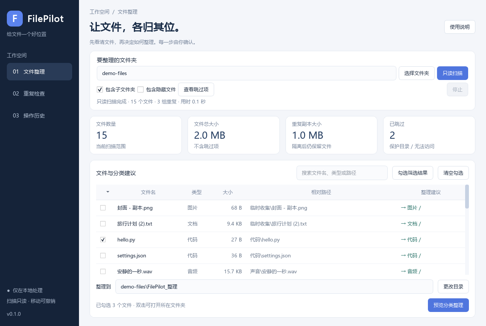
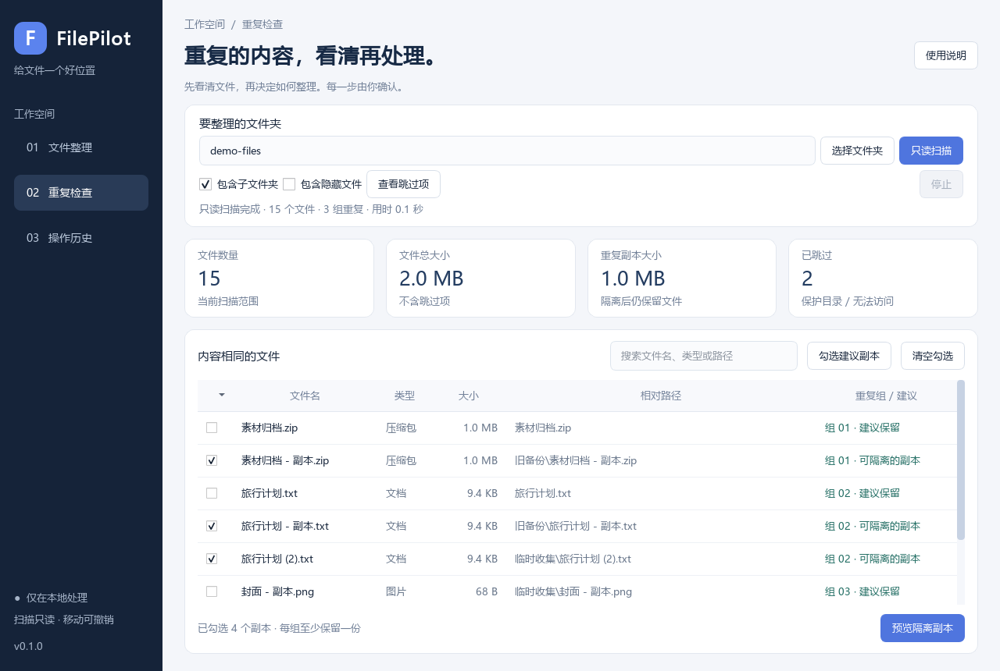

# FilePilot

[](https://github.com/jinzhengwang60-del/FilePilot/actions/workflows/test.yml)

**先看清文件，再决定如何整理。** 一个面向 Windows 的本地文件管理 MVP：只读扫描、分类建议、SHA-256 重复检查、执行前预览、安全移动、SQLite 历史和撤销。桌面界面使用 Python + PySide6，文件处理核心可脱离 UI 单独运行。

当前版本：`0.1.0`。默认离线，不调用模型 API，不上传文件，不收集遥测。第一版的“智能”来自可解释的扩展名规则和内容哈希。

源码仓库提供程序、测试与打包脚本。自行构建后，可以双击 `dist/FilePilot/FilePilot.exe`，无需安装 Python。源码运行与重新打包的方法如下。

## 快速启动

需要 Windows、Python 3.11+；本次开发环境实际使用 Python 3.13.9 / PySide6 6.9.2 / PyInstaller 6.22.3。

在项目目录打开 PowerShell。已有 PySide6 时：

```powershell
git clone https://github.com/jinzhengwang60-del/FilePilot.git
cd FilePilot
python run.py
# 或使用启动脚本
.\start.ps1
```

全新环境推荐独立虚拟环境，不需要激活即可运行：

```powershell
python -m venv .venv
.\.venv\Scripts\python.exe -m pip install -r requirements.txt
.\.venv\Scripts\python.exe run.py
```

如果 PowerShell 策略不允许运行 `.ps1`，直接用上述 Python 命令即可。项目不修改系统执行策略。依赖安装需要网络，软件运行和文件处理无需网络。

## 使用流程

1. 选择一个具体文件夹，点击 **只读扫描**。可选择是否包含子文件夹、隐藏文件。
2. 在 **文件整理** 中搜索、勾选文件，选择整理目录，点击 **预览分类整理**。
3. 核对每条来源与目标，勾选确认项，再点击确认移动。
4. 在 **重复检查** 查看哈希相同的文件，可勾选副本并预览移入隔离区；每组必须保留至少一份。建议保留较早修改的文件，可以自行改选。
5. 在 **操作历史** 查看每条文件记录，预览并确认撤销。原位置被占用或目标文件已改变时，撤销会停止并说明原因。
6. 文件位置改变后重新扫描再继续整理，避免使用过期结果。

撤销恢复文件的位置、内容和原有修改时间，会保留已经创建的空整理目录，避免影响其他文件。

默认分类目标为 `<扫描目录>/FilePilot_整理/<类型>/文件名`，分类包括图片、文档、视频、音频、压缩包、代码、安装包、其他。重名会在预览中分配 `文件名 (2).扩展名`；预览后又出现冲突时，执行会阻止覆盖并要求重新预览。

重复文件隔离到 `<扫描目录>/.filepilot-quarantine/<批次目录>/原相对路径`。**隔离区保留完整文件，隔离不会立刻释放磁盘空间。** 本版没有永久删除或清空隔离区功能。

## 使用演示文件

演示文件全部由程序生成，不使用个人文件，包括文本、CSV、Python、PNG、WAV、ZIP，共 15 个文件、3 组重复内容。

```powershell
python run.py --demo
# 或
.\start.ps1 -Demo
```

`--demo` 在当前目录新建 `demo-files` 并预填路径，仍需点击扫描。已存在且带有专用标记的演示目录只会重新加载，不覆盖其中的文件；遇到普通同名目录会拒绝创建。请在项目目录运行该命令。

## 工程结构

```text
FilePilot/
  src/filepilot/
    models.py          不可变扫描结果和移动计划
    categories.py      可解释的分类规则
    safety.py          路径、敏感目录、链接及快照校验
    scanner.py         只读遍历、按大小分组、稳定 SHA-256
    planner.py         分类 / 隔离计划与冲突命名
    journal.py         SQLite 历史和进程间操作锁
    operations.py      执行、撤销、中断记录核对
    ui_models.py       Qt 表格模型、筛选、勾选
    ui.py              三个桌面页面与后台任务
    app.py             桌面入口
    cli.py             只读命令行入口
    demo.py            专用演示数据
  tests/               核心安全测试与桌面流程测试
  scripts/build.ps1    Windows 打包脚本
  FilePilot.spec       PyInstaller 目录式打包配置
  run.py               源码启动入口
  start.ps1            本地便捷启动
```

核心模块只依赖 Python 标准库。Qt 导入位于桌面模块中；命令行扫描不创建历史库，也不需要加载 Qt。

## 安全边界与历史记录

- 扫描和计划生成不会修改扫描目录。读取文件可能使操作系统更新访问时间，这不由应用控制。
- 拒绝扫描磁盘根目录、Windows / Program Files / ProgramData / 用户 AppData、`.ssh` / `.aws` / `.gnupg` 等敏感路径。遍历时跳过相应子目录。
- 跳过符号链接、Windows 联接点、所有重解析点、硬链接和特殊文件；额外用目录标识防止循环。部分 OneDrive 文件属于重解析点，也会被跳过。
- 默认跳过隐藏项、`.git`、`.venv`、`node_modules`、`__pycache__`、默认整理目录和隔离区。勾选“包含隐藏文件”不解除敏感目录或链接保护。
- SHA-256 对大小相同的候选文件进行分块读取，并检查读取前后大小、修改时间、设备和文件标识。不能稳定读取的文件会出现在跳过记录中。
- 执行前核对整个批次；正式移动前再次校验来源，并验证文件内容。没有哈希的唯一大小文件在执行前首次计算哈希；不能识别扫描后被刻意改写并保持所有元数据的此类文件。
- **首版仅支持同一磁盘移动。** Windows 使用不覆盖已有目标的原生重命名，保留文件本身、NTFS 附加数据流和元数据；跨磁盘目标会被拒绝。核心在 POSIX 使用排他硬链接后移除旧路径，不使用会覆盖目标的 `rename`。
- 移动前先提交每个文件的路径、快照和内容哈希，逐文件提交状态。整个批次并非单个文件系统事务：中途失败会立即停止，已移动的文件仍可从历史中撤销。
- 中断记录检查只核对路径和内容并修正数据库状态，不会自动移动、删除或覆盖文件。存在两份路径、内容不一致或路径不明时，保留文件并标记“需要检查”。
- 撤销前核对全部待恢复文件；原位置已存在任何条目（包括断开的链接）、内容改变、目录受保护时，阻止覆盖。历史需要检查的条目不会自动处理。
- OS 文件锁防止使用同一历史数据库的进程同时执行移动 / 撤销；进程退出后锁会由系统释放。
- 保护检查降低普通误操作和文件变化风险，不能完全防御另一个恶意进程在校验与操作间替换路径。请在自己控制的普通文件夹内使用，不把它作为不可信共享目录的安全隔离机制。

默认数据库：`%LOCALAPPDATA%/FilePilot/history.sqlite3`。其中保存本地绝对路径、文件大小、时间、SHA-256 与操作状态，不保存文件内容。可用 `--data-dir <目录>` 指定其他位置。数据库丢失后无法依据历史自动撤销，请保留数据库与文件；移动应用安装目录不会移动用户数据库。

重复检测比较普通文件的主数据流，扩展名、文件名、权限和附加数据流不参与内容哈希，因此“内容相同”不表示所有元数据相同。分类规则基于扩展名，不读取语义，也不会执行文件。

## 只读命令行

在源码目录使用下面的命令；如果安装了 `pip install -e .`，也可直接运行 `filepilot-cli`。

```powershell
$env:PYTHONPATH = (Join-Path (Get-Location) 'src')
python -m filepilot scan .\demo-files
python -m filepilot scan .\demo-files --json
python -m filepilot plan .\demo-files --target .\demo-files\FilePilot_整理 --json
python -m filepilot demo --output .\another-demo
```

`scan` / `plan` 仅输出信息。没有命令行移动或删除命令，实际操作从桌面预览与确认进入。JSON 可能包含路径，不会自动写盘或上传。

## 测试

```powershell
.\.venv\Scripts\python.exe -m pip install -r requirements-dev.txt
.\.venv\Scripts\python.exe -m pytest
```

已有开发依赖时直接运行 `python -m pytest`。Qt 测试使用 `offscreen`，测试数据在项目 `artifacts/test-work/<随机目录>` 中创建，不扫描或整理个人文件。

测试包括内容去重、同大小不同内容、隐藏与缓存排除、访问拒绝、链接循环、硬链接、敏感目录、预览零副作用、明确确认、重名竞争、变化文件、中断恢复、同盘移动、保留副本、撤销冲突、跨进程锁，以及桌面扫描 → 预览 → 移动 → 历史 → 撤销的实际流程。GitHub Actions 在 Windows 上分别使用 Python 3.11、3.13 自动运行测试，结果见仓库的 Actions 页面。

首次公开前的本机验证结果见 [验证记录](docs/VALIDATION.md)。本机原始报告、历史数据库、临时测试文件、生成的演示文件与构建产物均不提交到仓库。

实际程序界面（使用生成的演示文件）：





截图使用真实的相对目录 `demo-files`，不展示个人目录。可在项目目录运行 `python scripts/capture_screenshots.py` 重新生成，截图过程只读扫描演示文件。

## Windows 打包

先在 Windows 安装开发 / 打包依赖，再从项目目录执行：

```powershell
.\.venv\Scripts\python.exe -m PyInstaller --noconfirm FilePilot.spec
# 或
.\scripts\build.ps1
```

输出为 `dist/FilePilot/FilePilot.exe`。**分发整个 `dist/FilePilot` 目录**（可压缩为 ZIP），不能只拷贝 EXE；用户无需另装 Python。使用目录式打包便于检查依赖和排查问题。构建 Windows 程序必须在 Windows 上进行。参见 [PyInstaller 官方使用说明](https://pyinstaller.org/en/stable/usage.html) 和 [Qt for Python 安装说明](https://doc.qt.io/qtforpython-6/gettingstarted.html)。

源码可按 MIT 使用。PySide6 / Qt 及打包工具适用各自许可；分发二进制时请同时提供相应许可文件，参见 [Qt for Python 许可说明](https://doc.qt.io/qtforpython-6/licenses.html)。

## 下一步

优先扩展可编辑分类规则、扫描结果导出、历史备份和大目录增量扫描。跨磁盘移动需要复制核验、完整元数据处理和可恢复的中断状态；加入语义分类前应先设计可选本地模型与明确的数据访问边界。
